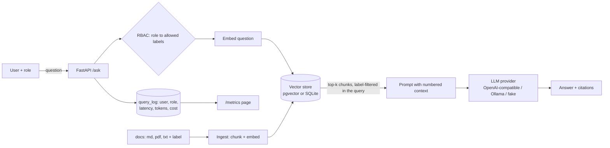

# Utility RAG Assistant

A question-answering assistant over utility documents (NERC CIP summaries, sample outage procedures, and real public LCRA flood and water supply pages) that cites its sources, enforces role-based access at retrieval time, logs cost per query, and ships with an eval suite that runs in CI. It runs on a hosted model API or fully on-prem with Ollama by changing one environment variable.

It is also a teaching repo. The [docs/](docs/) folder walks through every decision step by step.

## The business problem

Field techs and compliance staff spend time hunting through procedures and standards. A utility cannot fix that by pasting documents into a public chatbot: some content is BES Cyber System Information under NERC CIP, and an answer that leaks it is a compliance event.

AI here is a force multiplier, not magic. It finds the right paragraph fast and quotes it with a citation. People still make the decisions.

## How we measure it

| Metric | Target | Where |
|---|---|---|
| Retrieval hit-rate on the golden set | ≥ 90% | `pytest`, CI |
| Answer accuracy on the golden set | ≥ 75% | `pytest`, CI |
| Restricted-content leaks | 0 | `tests/test_rbac.py` |
| Cost and latency per query | tracked | `/metrics`, `/dashboard` |
| Unanswered rate and user feedback | tracked | `/dashboard` gap report |

Current result with the offline provider: **100% retrieval hit-rate, 95% answer accuracy (21 golden questions), 0 leaks, all tests pass in CI.**

## Architecture



## LCRA proof of concept: Highland Lakes flood and water supply

The repo includes 18 real public pages from [lcra.org](https://www.lcra.org) on flood operations, the six Highland Lakes dams, the Water Management Plan, drought curtailment and firm water contracts, plus an optional live tool that reads current lake levels from [LCRA Hydromet](https://hydromet.lcra.org/Reports/LakeLevel). These are the questions LCRA staff and customers ask every rain event and every drought month. See [docs/09-lcra-poc.md](docs/09-lcra-poc.md) for why this data, how it was ingested, and what a production rollout would need.

Pick user **guest** and try:

- At what Lake Travis elevation can LCRA begin floodgate releases from Mansfield Dam?
- What is the current level of Lake Travis? *(live Hydromet reading, `HYDROMET_LIVE=1`)*
- What is the initial minimum curtailment percentage in the Drought Contingency Plan?
- Is FONS a flood warning service?
- What is the firm water rate per acre-foot starting with the January 2027 billing cycle?

The assistant retrieves and cites. It does not predict releases or issue warnings; for those, people follow NWS, local emergency management, and LCRA's Flood Operations Notification Service.

## Demo day

Use an API key for the live demo. Answers are fuller and faster, and there is nothing to install in the room.

```bash
cp .env.example .env      # LLM_PROVIDER=openai is already set
# edit .env: OPENAI_API_KEY=sk-...   (optional: OPENAI_CHAT_MODEL=gpt-4o-mini)
docker compose up --build
```

`.env` is in `.gitignore`. Never commit a key.

For on-prem, change one line: `LLM_PROVIDER=ollama`. Same app, same documents, no data leaves the building. With no key and no network, `LLM_PROVIDER=fake` still runs everything, including the storm briefing.

Click **Storm briefing** to show live Lake Travis and Lake Buchanan levels against the floodgate and key elevations, what operations happen at each level, and how FONS notifications work, all with citations and the reading time in Central time. See [chapter 9](docs/09-lcra-poc.md#storm-briefing-decision-support).

## Measure it: usage and value dashboard

Open `http://localhost:8000/dashboard` for questions per day, cost, latency, the unanswered rate, thumbs up and down from the chat page, eval scores over time, and a **gap report** that groups the questions it couldn't answer by topic and suggests which documents to add next. See [chapter 10](docs/10-measure-and-govern.md).

## Show the access control and govern the data

- `http://localhost:8000/compare`: the same question asked as two users, side by side. Sources only one role can see are highlighted.
- `http://localhost:8000/governance`: every data source with its owner, label, link, chunk count and freshness, plus the active model and whether data leaves the network. Owners are set in `data/governance.yaml`. Starter policy: [docs/policy-notes.md](docs/policy-notes.md), mapped to the NIST AI RMF.

## Quickstart (no keys, no Docker)

```bash
pip install -r requirements.txt
pytest -q                      # ingest, RBAC leak tests, API, briefing, dashboard, evals
python -m evals.run_evals      # eval report
uvicorn app.main:create_app --factory --reload
# open http://localhost:8000 and try users guest, maria, dev
```

## With Docker (Postgres + pgvector)

```bash
cp .env.example .env           # set LLM_PROVIDER=openai and OPENAI_API_KEY for a real model
docker compose up --build
```

After pulling new documents or changing the embedding model, reset the database once so it re-ingests: `docker compose down -v && docker compose up --build` (or, as an admin user, `curl -X POST -H "X-User: tim" localhost:8000/admin/reingest`).

## On-prem mode (no data leaves the building)

```bash
docker compose --profile onprem up -d ollama
docker compose exec ollama ollama pull llama3.1:8b
docker compose exec ollama ollama pull nomic-embed-text
LLM_PROVIDER=ollama docker compose up --build app
```

Any OpenAI-compatible server (vLLM, LM Studio, Azure OpenAI) also works with `LLM_PROVIDER=openai` and `OPENAI_BASE_URL`.

## Demo users

| User | Role | Can read |
|---|---|---|
| guest | public | public |
| maria | field-tech | public, field-tech |
| dev | cip-analyst | public, field-tech, cip-restricted |
| tim | cip-analyst | public, field-tech, cip-restricted |

Unknown users get `public`. Unlabeled documents get `cip-restricted`. Both fail closed.

## Data

- `cip-*.md`: plain-language summaries written for this demo, not official text. Source: https://www.nerc.com/pa/Stand/Pages/CIPStandards.aspx
- `sample-*.md`: **SAMPLE / fictional** procedures and fake restricted content. Not real utility data.

## Status

Works and is tested: ingestion and chunking, citations, RBAC with leak tests, query logging and `/metrics`, golden-set evals in CI, the fake provider, the SQLite store, the web chat page.

Written but not yet tested end to end: the OpenAI and Ollama providers. `docker compose` runs (verified by Tim on Linux). See [docs/08-next-steps.md](docs/08-next-steps.md).

## Tutorial

1. [What RAG is and why](docs/01-rag.md)
2. [Embeddings](docs/02-embeddings.md)
3. [Chunking and ingestion](docs/03-chunking.md)
4. [Access control](docs/04-rbac.md)
5. [Cost and logging](docs/05-cost.md)
6. [Evals](docs/06-evals.md)
7. [Running on-prem](docs/07-on-prem.md)
8. [Next steps](docs/08-next-steps.md)
9. [LCRA proof of concept](docs/09-lcra-poc.md)
10. [Measure and govern](docs/10-measure-and-govern.md)

License: MIT. Author: Tim Serewicz.
